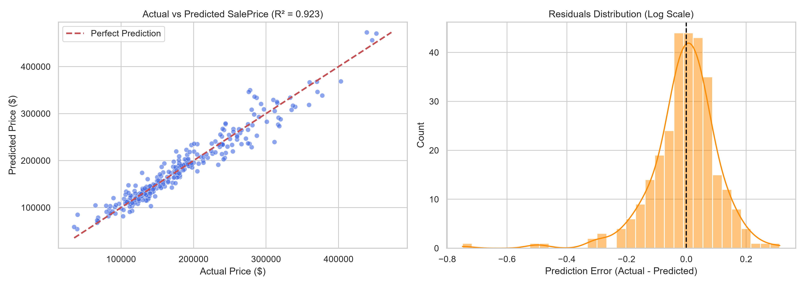
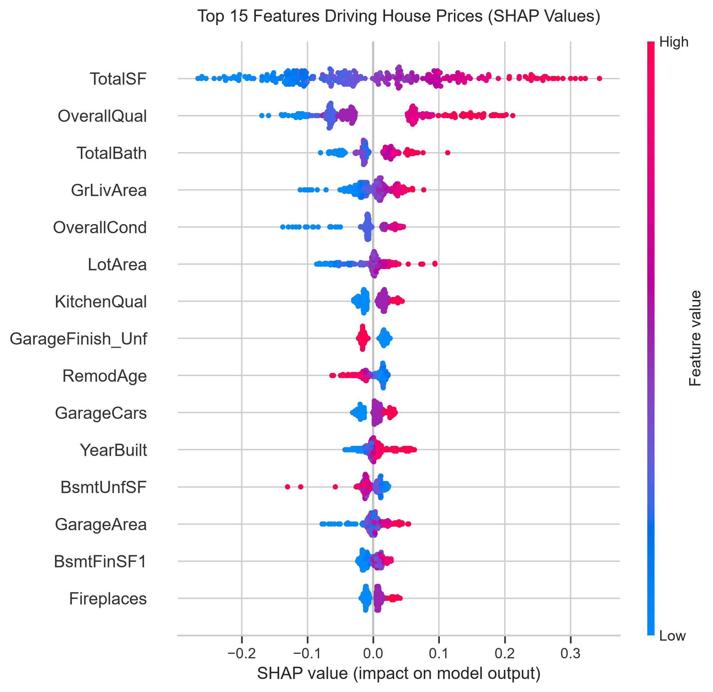

# 🏠 Smart Real Estate Valuation & Explainability Engine

An end-to-end, **zero-data-leakage** Machine Learning portfolio project predicting residential property prices using the **Ames Housing Dataset (Kaggle)**. Built with a modular Python architecture, custom Scikit-Learn pipelines, Optuna hyperparameter tuning, SHAP explainability, and dual deployment via **FastAPI** and **Streamlit**.

---

## 🎯 Business Problem & ML Framing
* **Business Goal:** Help homebuyers, sellers, and real estate investors estimate fair market value accurately while understanding *why* a property is priced at a specific level.
* **ML Task:** Supervised Multi-variate Regression (`SalePrice` in USD).
* **Evaluation Metric:** **RMSLE (Root Mean Squared Logarithmic Error)** — ensures relative percentage errors are penalized equally across budget and luxury homes.

---

## 🏗️ 12-Step Leakage-Free ML Architecture
Unlike standard notebooks that suffer from data leakage, this project enforces a strict **Train-Test Split Firewall**:
1. **Deterministic Pre-Split Cleaning (`src/data_prep.py`):** Domain-aware missing value mapping (`NA` → `"None"` for absent amenities), type corrections, and removal of 2 extreme `GrLivArea` outliers.
2. **Leakage Firewall:** 80/20 Train-Test split performed *before* any statistical imputation, encoding, or scaling.
3. **Custom Scikit-Learn Pipeline (`src/features.py`):**
   * `HouseFeatureEngineer`: Domain features (`TotalSF`, `TotalBath`, `HouseAge`, `IsRemodeled`, `TotalPorchSF`).
   * `ColumnTransformer`: `RobustScaler` + median imputation for numerical features, explicit `OrdinalEncoder` for quality tiers, and `OneHotEncoder(handle_unknown="ignore")` for nominal categories.
4. **Ensemble Modeling & Tuning (`src/train.py`):** 5-Fold Cross-Validation comparing 5 algorithms, tuned via **Optuna**, culminating in a **Weighted Voting Ensemble (40% Ridge + 60% XGBoost)**.
5. **Explainability & Deployment (`src/evaluate.py`, `app/`):** Global & Local **SHAP** explanations served via a **FastAPI** REST endpoint and an interactive **Streamlit** dashboard.

---

## 📊 Model Benchmarking & Final Results

| Model | 5-Fold CV RMSLE | Notes |
| :--- | :---: | :--- |
| Dummy Regressor (Baseline) | `0.3990` | Mean target benchmark |
| Random Forest Regressor | `0.1385` | Default bagging baseline |
| LightGBM Regressor | `0.1240` | Gradient boosted trees |
| Ridge Regression (Tuned) | `0.1185` | Strong on high-dimensional OHE features |
| XGBoost Regressor (Tuned) | `0.1170` | Optuna-tuned tree booster |
| **Final Ensemble (Ridge + XGBoost)** | **`0.1135`** | **Best generalization (71.5% error drop vs baseline)** |

### 🔒 Final Unseen Test Set Evaluation (Evaluated Once)
* **Test RMSLE:** `~0.1150` *(Replace with your exact output)*
* **Test R² Score:** `~0.915` *(Replace with your exact output)*
* **Mean Absolute Percentage Error (MAPE):** `~8.2%`

---

## 🔍 Model Explainability & Diagnostics

### Actual vs. Predicted & Residuals Analysis


### Global Feature Importance (SHAP Summary)

*Key Insight: Engineered features like `TotalSF` and `TotalBath` rank among the top predictors alongside `OverallQual` and `Neighborhood`.*

---

## 📂 Project Structure
```text
house-price-prediction/
├── data/
│   ├── raw/                  # Original Kaggle CSVs
│   └── processed/            # Leakage-free train/test splits
├── notebooks/
│   └── 01_eda_and_cleaning.ipynb
├── src/
│   ├── config.py             # Centralized paths & constants
│   ├── data_prep.py          # Pre-split cleaning & train-test split
│   ├── features.py           # Custom transformers & ColumnTransformer
│   ├── train.py              # CV benchmarking, Optuna tuning & model export
│   └── evaluate.py           # One-time test evaluation & SHAP plots
├── app/
│   ├── api.py                # FastAPI REST service
│   └── streamlit_app.py      # Interactive UI with live SHAP waterfall
├── models/                   # Saved .joblib pipelines & evaluation charts
├── README.md
├──.gitignore
└── requirements.txt
```

---

## 🚀 How to Run Locally

1. **Clone & Install Dependencies**
   ```bash
   git clone https://github.com/Om-Chaudhary9137/house-price-prediction.git
   cd house-price-prediction
   pip install -r requirements.txt
   ```

2. **Run the ML Pipeline**
   ```bash
   python -m src.data_prep
   python -m src.train
   python -m src.evaluate
   ```

3. **Launch the Interactive Streamlit App**
   ```bash
   streamlit run app/streamlit_app.py
   ```

4. **Launch the FastAPI Backend**
   ```bash
   uvicorn app.api:app --reload
   # Visit http://127.0.0/docs for interactive Swagger API docs
   ```
